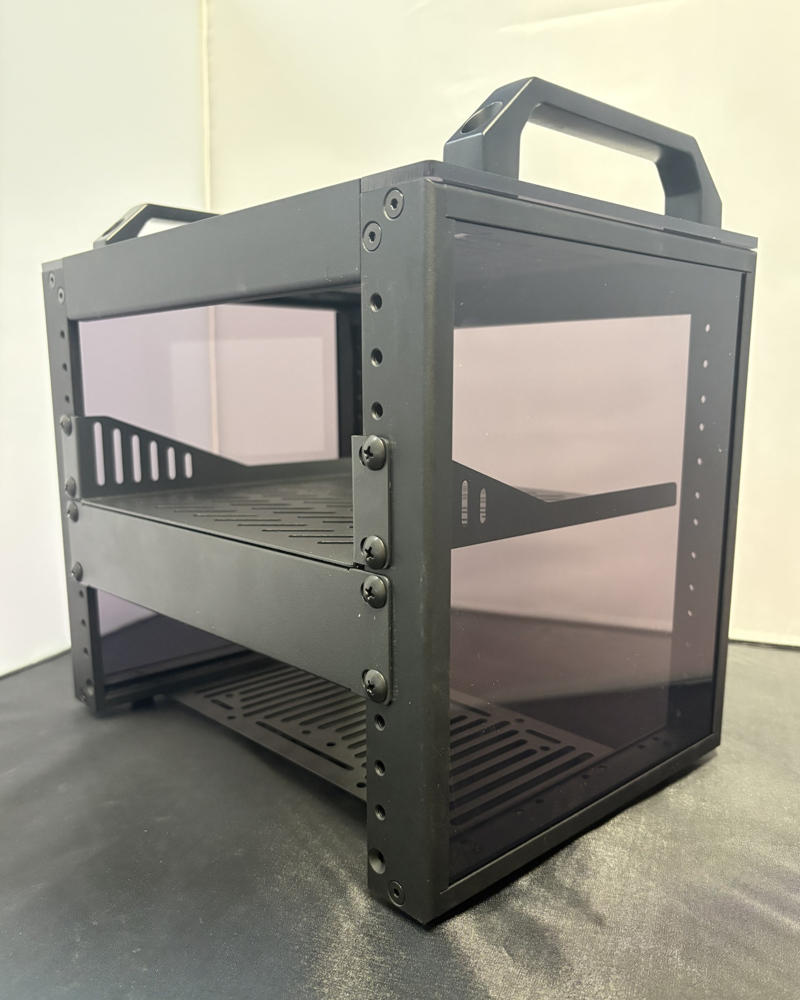
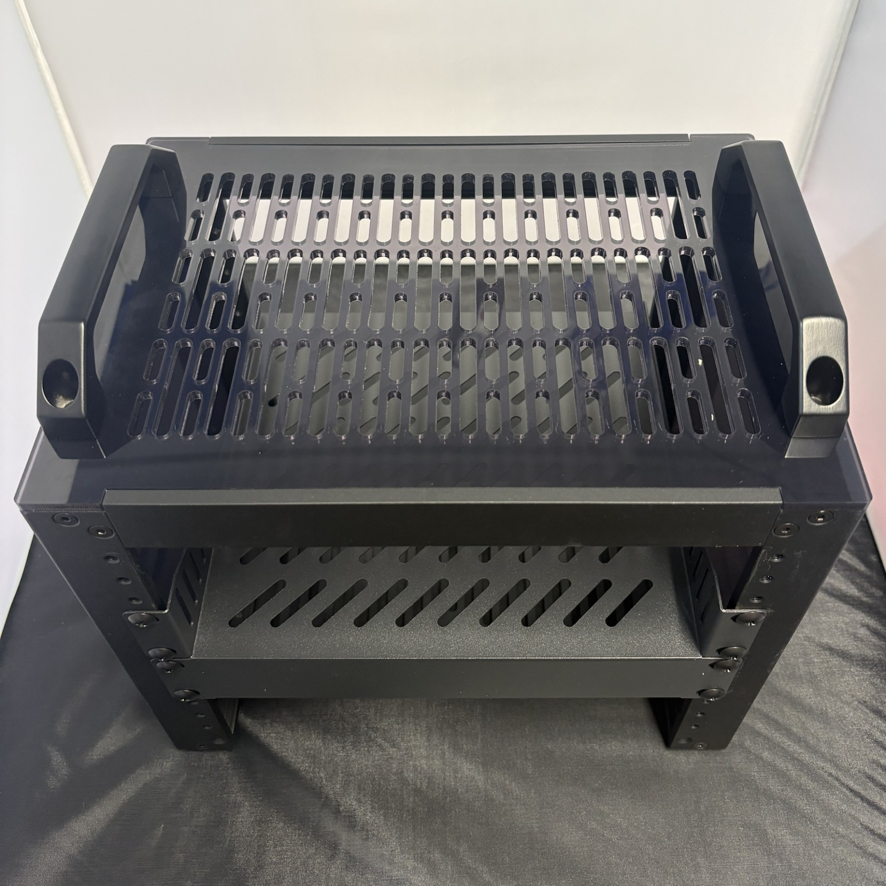

# Raspberry Pi Homelab

My first homelab: a Raspberry Pi 5 in a 10 inch rack. I started this repo to plan it and now use it to document the build. I'm doing it to learn networking and security hands-on, instead of just reading about it.

## Why I'm building it

- To learn how networks work in practice
- To block ads and trackers on my devices
- To practise securing devices and remote access
- To have a safe space to test things as I learn cyber security

## What it runs

- **Hardware:** Raspberry Pi 5 (2GB), TP-Link managed switch and a 1TB drive in a DeskPi RackMate T0. About £240
- **Pi-hole** to block ads on my own devices, including my phone anywhere over Tailscale
- **Tailscale** for remote access and as an exit node, with no ports forwarded on my router
- **Security:** UFW, Fail2ban, Lynis hardening, automatic updates and an OpenCanary honeypot
- **Jellyfin** media server, nightly backups and a private Homepage dashboard
- **A public status page** at [haydnhomelab.com](https://haydnhomelab.com) through a Cloudflare Tunnel

I designed the rack layout and network before buying anything so I knew exactly what I needed.

## Build so far

  
  
  

The DeskPi RackMate T0 when it arrived. The Pi and switch are fitted now (see the [rack layout](diagrams/rack-layout.png)), and I'll add new photos soon.

## What's in this repo

- [Parts list](parts-list.md) - what I bought and why
- [Security plan](security-plan.md) - how it's secured and tested
- [Research notes](research-notes.md) - what I learned while planning
- [Build log](build-log.md) - how the build is going, problems and fixes
- [Photos](photos/) - photos of the build as it goes
- [Media](media/) - Jellyfin media server
- [Backup](backup/) - nightly backups and how to restore
- [Honeypot](honeypot/) - fake services that alert me if anything pokes around my network
- [Homepage](homepage/) - my private dashboard, running in Docker
- [Diagrams](diagrams/) - rack layout and my original network plan (the up-to-date map is on the status page, press N)
- [Status page](status-page/) - live at [haydnhomelab.com](https://haydnhomelab.com), served from the Pi through a Cloudflare Tunnel

## How I built this

I used Claude (an AI assistant) a lot on this project, so I want to be clear about who did what.

- **Claude wrote all the code** in this repo: the status page website and its stats scripts, the backup script, the honeypot setup and the Homepage config. I don't have the coding skills to write those myself yet.
- **Claude guided me through the setup** step by step, and gave me the commands for the Pi: SSH keys, UFW, Pi-hole, Tailscale, Fail2ban, Lynis, Jellyfin, Docker, the honeypot and the Cloudflare Tunnel.
- **Claude made the diagrams** and cleaned up the rack photos, and helped me write up these notes.
- **I** chose and bought the parts, built the rack, ran every command on the Pi myself, tested that things worked (like the Nmap scans and the Fail2ban test), and decided how the lab is set up, like only using Pi-hole on my own devices.

Commits that Claude helped with have Claude listed as a co-author.

## Progress

- [x] Decide on budget and goals
- [x] Learn networking basics
- [x] Research Pi-hole and DNS
- [x] Research remote access (VPNs)
- [x] Research hardware
- [x] Finish parts list
- [x] Draw network diagram
- [x] Design rack layout
- [x] Write security plan
- [x] Buy parts
- [x] Flash the SD card and set up SSH with keys
- [x] Firewall (UFW) and automatic security updates
- [x] Pi-hole (tested on my Mac)
- [x] Tailscale remote access
- [x] Fit everything in the rack
- [x] Live status page
- [x] Pi-hole on my own devices (Mac, PC, and my phone anywhere over Tailscale)
- [x] Security testing (Nmap scan, only the ports I opened show up)
- [x] Fail2ban
- [x] Lynis security audit (hardening score 63 to 75)
- [x] Jellyfin media server with a 1TB drive
- [x] Nightly backups
- [x] Tailscale exit node (a free VPN through home)
- [x] Honeypot (OpenCanary, home network only)
- [x] Homepage private dashboard (Docker)

## Next

- VLANs on the managed switch
- Copy backups off the Pi (3-2-1 rule)
- Alerts to my phone if something goes down
- An SSD instead of the SD card
