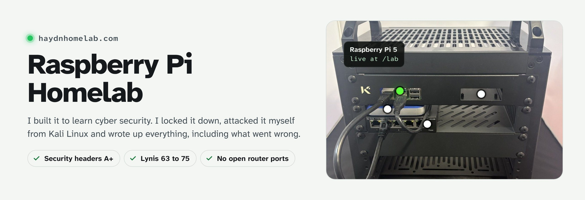
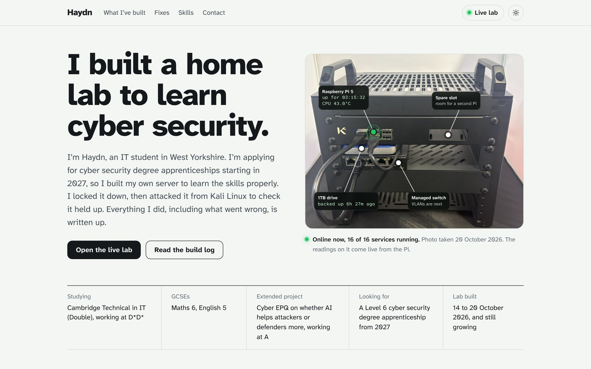
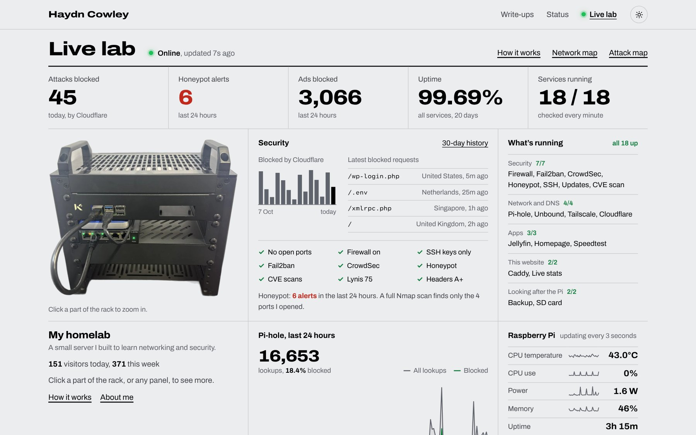
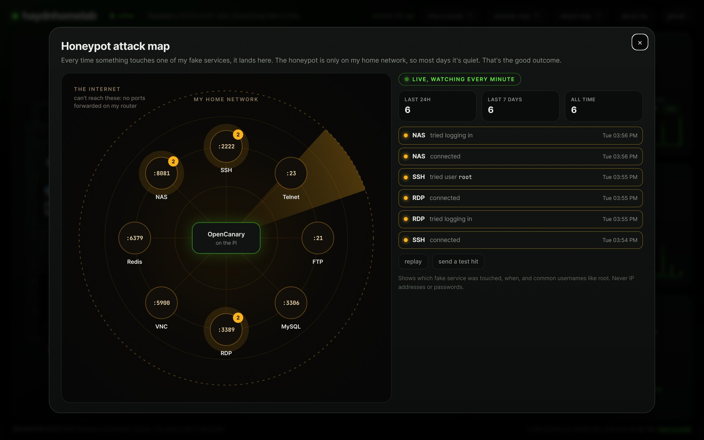
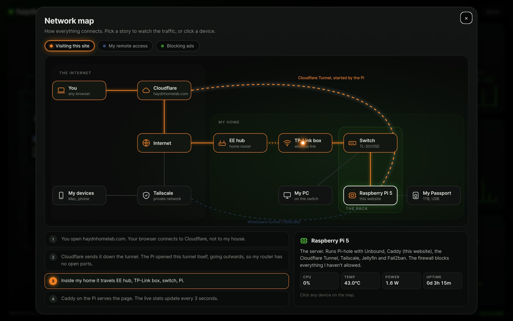
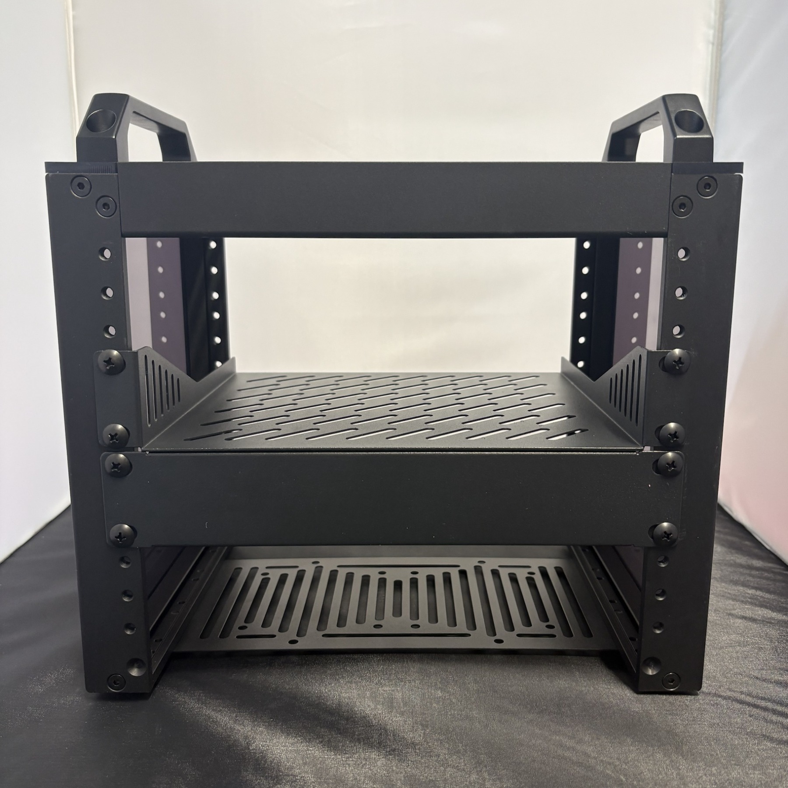

<picture>
  <source media="(prefers-color-scheme: dark)" srcset="images/banner-dark.jpg">
  
</picture>

  <a href="https://haydnhomelab.com"><b>Portfolio</b></a> &nbsp;|&nbsp;
  <a href="https://haydnhomelab.com/lab/"><b>Live lab</b></a> &nbsp;|&nbsp;
  <a href="docs/build-log.md"><b>Build log</b></a> &nbsp;|&nbsp;
  <a href="docs/security-plan.md"><b>Security testing</b></a> &nbsp;|&nbsp;
  <a href="https://www.linkedin.com/in/haydncowley"><b>LinkedIn</b></a>

  
  
  
  
  
  
   
  
  
  

I'm Haydn, an IT student in West Yorkshire applying for cyber security degree apprenticeships starting in 2027. This is my homelab: a Raspberry Pi 5 in a 10 inch rack that blocks ads on my devices, lets me reach my home network safely from anywhere, runs a honeypot to catch anything poking around and hosts my website. The badges above are live from the Pi.

## At a glance

<table>
  <tr><td><b>Built</b></td><td>14 to 20 October 2026, and still growing</td></tr>
  <tr><td><b>Hardware</b></td><td>Raspberry Pi 5 (2GB), TP-Link TL-SG105E managed switch and a 1TB drive in a DeskPi RackMate T0, about £240 (<a href="docs/parts-list.md">parts list</a>)</td></tr>
  <tr><td><b>Runs</b></td><td>Pi-hole, Unbound, Tailscale, a honeypot, a media server and more. 16 things are checked every minute on the <a href="https://haydnhomelab.com/lab/">live lab</a></td></tr>
  <tr><td><b>Open to the internet</b></td><td>Nothing on my router. My website reaches the internet through a Cloudflare Tunnel that the Pi opens outwards</td></tr>
  <tr><td><b>Results</b></td><td>Lynis hardening 63 to 75, security headers F to A+, and only the 4 ports I opened show up in a full Nmap scan</td></tr>
</table>

## Screenshots

<table>
  <tr>
    <td width="50%" valign="top">
      
      
<b>Portfolio</b> What I've built, with the proof next to each part. The readings on the rack photo are live from the Pi.

    </td>
    <td width="50%" valign="top">
      
      
<b>Live lab</b> Real-time stats from the Pi, every service it runs, and graphs of the last 24 hours.

    </td>
  </tr>
  <tr>
    <td width="50%" valign="top">
      
      
<b>Honeypot attack map</b> My own test attacks from Kali landing on the fake services. It never shows IP addresses or passwords.

    </td>
    <td width="50%" valign="top">
      
      
<b>Network map</b> How a visit reaches the Pi without any open ports, animated step by step.

    </td>
  </tr>
</table>

Screenshots taken on 20 October 2026 with real data from the Pi.

## How I tested it

I didn't want to set things up and just hope they worked, so I tested each part, usually by attacking it myself.

| What I tested | How | Result |
|---|---|---|
| SSH logins | Forced a password login | Refused. Only my SSH key works |
| Firewall | Nmap scan of all 65,535 ports from another computer | Only the 4 ports I opened showed up |
| Fail2ban | 5 wrong SSH logins from my Kali VM | Its IP was banned for an hour |
| Hardening | Lynis security audit | Score went from 63 to 75 |
| Private DNS | `dig` a domain with deliberately broken DNSSEC | Refused with SERVFAIL, so faked answers get blocked |
| Website headers | securityheaders.com | F to A+ |
| Cloudflare firewall | `curl` attack paths, then 1,000 fast requests | Attack paths got 403, and 785 requests were rate limited |
| Honeypot | Connected to the fake services from Kali | Every hit was logged straight away |
| Backups | Restored my firewall rules from a backup | `diff` showed the files were identical |
| Secrets on GitHub | gitleaks scans every commit on every push | All 88 commits clean, and a fake token in a test repo was caught |

The commands, results and screenshots are in the [security plan](docs/security-plan.md).

## What it runs

<table>
  <tr><td><b>Security</b></td><td>UFW firewall, Fail2ban, OpenCanary honeypot, SSH with keys only, automatic security updates</td></tr>
  <tr><td><b>Network and DNS</b></td><td>Pi-hole, Unbound with DNSSEC, Tailscale (remote access and an exit node), Cloudflare Tunnel</td></tr>
  <tr><td><b>Apps</b></td><td>Jellyfin media server, Homepage dashboard and Speedtest Tracker in Docker, and a Samba share</td></tr>
  <tr><td><b>Web</b></td><td>Caddy serving my portfolio and live lab, plus <code>.lan</code> names for my private services</td></tr>
  <tr><td><b>Looking after the Pi</b></td><td>Nightly backups with a tested restore, and SD card health checks</td></tr>
</table>

## The rack

  
  
  

The Pi sits in a KKSB panel at the top, with room for a second one. The 1TB drive rests on the switch on the shelf below. There's a [labelled rack layout](images/rack-layout.png) too.

## What's in this repo

**Start here:**

- [Build log](docs/build-log.md): everything I did, day by day, including what went wrong and how I fixed it
- [Security plan](docs/security-plan.md): how the lab is secured, and all my test results
- [Parts list](docs/parts-list.md): what I bought and why
- [Research notes](docs/research-notes.md): what I learned while planning

**Setup files** (configs and scripts, in [setup](setup/)):

| Folder | What's in it |
|---|---|
| [website](setup/website/) | My portfolio at haydnhomelab.com, the live lab at /lab, and the scripts that feed them live stats |
| [honeypot](setup/honeypot/) | Fake services that alert me if anything pokes around my network |
| [backup](setup/backup/) | Nightly backups and how to restore |
| [homepage](setup/homepage/) | My private dashboard |
| [speedtest](setup/speedtest/) | Tests my broadband every 2 hours |
| [caddy](setup/caddy/) | Web server config for my website and the `.lan` names |

## How I built this

I used Claude (an AI assistant) a lot on this project, so I want to be clear about who did what.

- **Claude wrote all the code** in this repo: my portfolio and live lab websites and their stats scripts, the backup script, the honeypot setup and the Docker and Caddy configs. I don't have the coding skills to write those myself yet.
- **Claude guided me through the setup** step by step, and gave me the commands for the Pi: SSH keys, UFW, Pi-hole, Tailscale, Fail2ban, Lynis, Jellyfin, Docker, the honeypot and the Cloudflare Tunnel.
- **Claude made the diagrams**, the banner and screenshots on this page, cleaned up the rack photos and helped me write up these notes.
- **I** chose and bought the parts, built the rack, ran every command on the Pi myself, tested that things worked (like the Nmap scans and the Fail2ban test), and decided how the lab is set up, like only using Pi-hole on my own devices.

Commits that Claude helped with have Claude listed as a co-author.

## Progress

<b>Done so far</b> (click to open)

- [x] Planning: budget, research, parts list, rack layout, security plan
- [x] Built the rack and set up the Pi with SSH keys only
- [x] UFW firewall and automatic security updates
- [x] Pi-hole on my Mac, PC and phone (anywhere, over Tailscale)
- [x] Tailscale remote access and exit node
- [x] Nmap scans to check only the ports I opened show up
- [x] Fail2ban, tested from Kali
- [x] Lynis audit and hardening (score 63 to 75)
- [x] Live dashboard on my own domain
- [x] Apprenticeship portfolio as my homepage, with live readings from the Pi
- [x] Jellyfin media server with a 1TB drive
- [x] Nightly backups, with a restore tested
- [x] OpenCanary honeypot, tested from Kali
- [x] Homepage and Speedtest Tracker in Docker
- [x] `.lan` names for my services
- [x] Unbound for private DNS lookups
- [x] Security headers on my site (F to A+ on securityheaders.com)
- [x] Cloudflare WAF rules and rate limiting, tested
- [x] Live badges on this README

**Next:**

- VLANs on the managed switch
- Copy backups off the Pi (3-2-1 rule)
- Alerts to my phone if something goes down
- An SSD instead of the SD card

## Contact

I'm looking for a Level 6 cyber security degree apprenticeship starting in 2027. Email me at cowleyhaydn@gmail.com, connect with me on [LinkedIn](https://www.linkedin.com/in/haydncowley), or have a look at my [portfolio](https://haydnhomelab.com).
