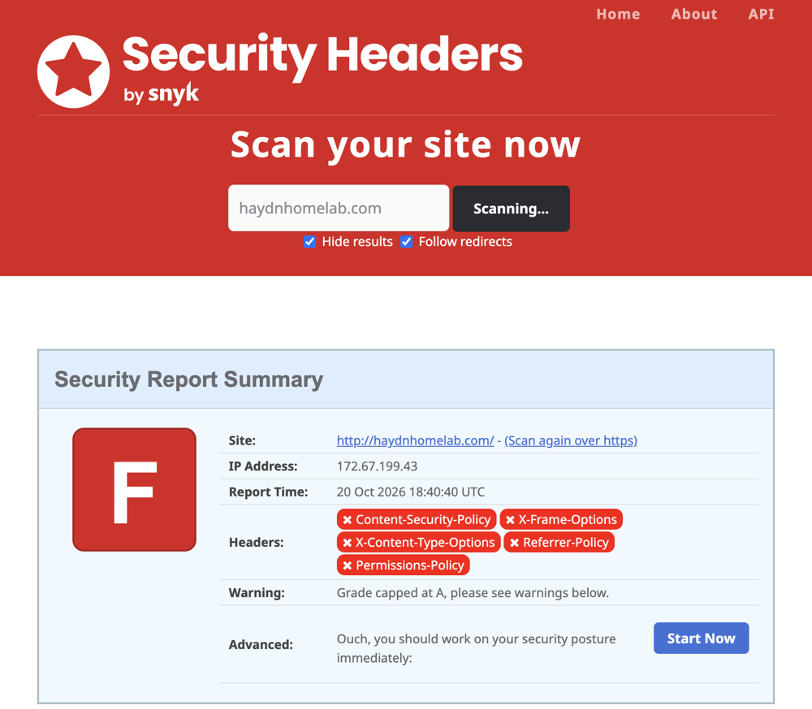
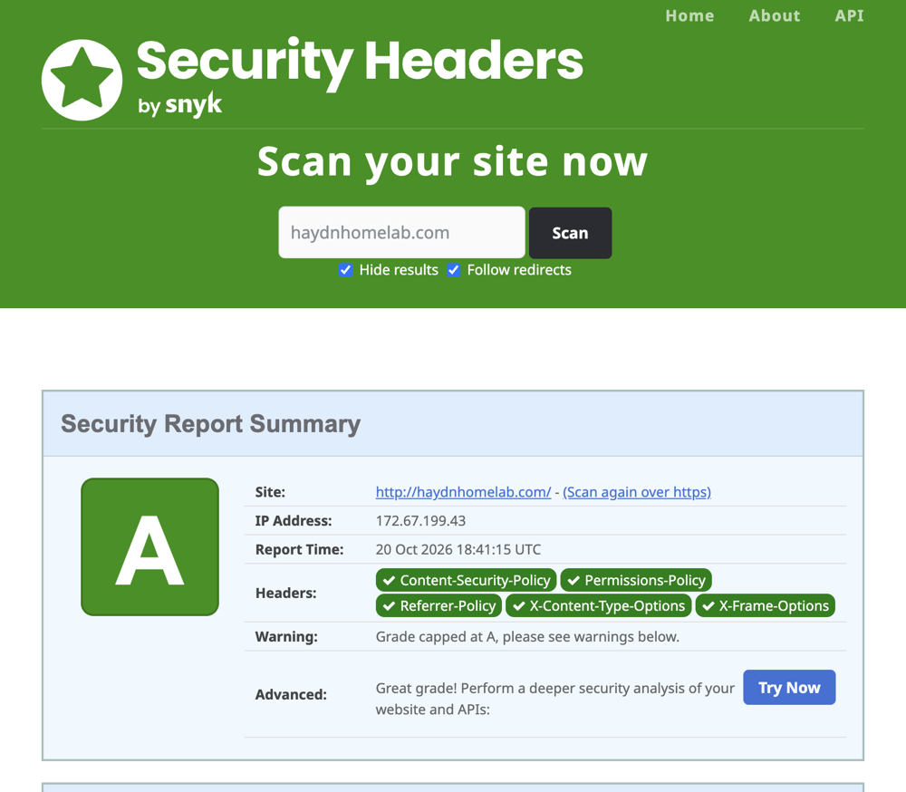
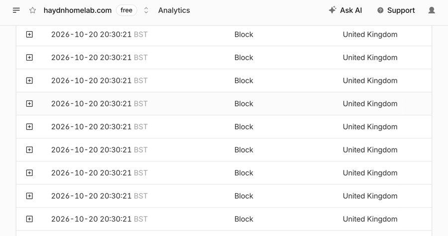

# Security Plan

How I keep my homelab secure, and how I've tested it. I started this as a plan before building and keep it updated.

**Jump to test results:** [Nmap](#nmap-results-home-network) | [Security headers](#security-headers-20-october-2026) | [Cloudflare WAF](#cloudflare-waf-20-october-2026) | [Lynis](#lynis-audit-18-october-2026) | [All tests](#testing)

## Status (20 October 2026)

- [x] Tailscale for remote access, with no port forwarding on my router
- [x] SSH keys only, password login over SSH turned off and tested
- [x] UFW blocks everything coming in except what's needed:
  - SSH from my home network and over Tailscale
  - DNS (53) for Pi-hole from my home network and over Tailscale
  - Pi-hole admin page (80/443), Jellyfin, Samba, Homepage and Speedtest Tracker from my home network and over Tailscale
  - Honeypot ports from my home network only
- [x] Pi-hole admin page has a password
- [x] Automatic security updates (`unattended-upgrades`)
- [x] Fixed IP for the Pi (`192.168.1.5`)
- [x] Back up Pi-hole with Teleporter (kept off the Pi and off GitHub, because it has password hashes in it)
- [x] Nmap scan from my Mac on the home network (results below)
- [x] Fail2ban: bans an IP in UFW after 5 failed SSH logins in 10 minutes (tested)
- [x] Lynis audit and hardening (score 63 to 75)
- [x] Honeypot on my home network (OpenCanary) to catch anything scanning or logging in where it shouldn't
- [x] Nightly backups, with a restore tested
- [ ] VLANs on the managed switch

## What I'm protecting against

- Someone accessing my Pi from the internet
- Weak or default passwords being guessed
- Out of date software with known vulnerabilities
- Losing my Pi-hole settings if something breaks

## Remote access

- **Tailscale** to reach the lab from outside my house, with 2FA on the account
- **No port forwarding** on my router. My website goes out through a Cloudflare Tunnel, which the Pi connects out to
- The Pi is a Tailscale exit node, so my devices can route their traffic through home on untrusted Wi-Fi. Forwarding is only allowed from `tailscale0` out to the internet (`ufw route allow in on tailscale0 out on eth0`), nothing else can be forwarded

## Logging in to the Pi

- My own username, set in Raspberry Pi Imager (no default `pi` user)
- **SSH keys** only, password login turned off once keys worked
- No logging in directly as root, and only my user is allowed over SSH

## Pi-hole

- Strong password on the admin page
- Admin page only reachable from my home network or over Tailscale
- My phone uses Pi-hole over Tailscale, so ads and trackers are blocked even on mobile data. DNS is only allowed from my home network and `tailscale0`
- Blocklists: the default StevenBlack list, plus HaGeZi Pro (ads and tracking) and HaGeZi Threat Intelligence Feeds Medium (known malware, phishing and scam domains). About 851,000 domains in total, updated automatically every week
- **Unbound** does the actual lookups itself, starting from the root DNS servers, instead of sending every site I visit to Google or Cloudflare. It checks DNSSEC signatures, so faked answers get refused (tested: `fail01.dnssec.works` gives SERVFAIL). It only listens on `127.0.0.1:5335`, so nothing new is open

## Firewall

- **UFW** on the Pi blocks everything coming in by default, and only allows what's listed in the status section above
- Private services have names like `jellyfin.lan`: Pi-hole's local DNS points them at the Pi and Caddy on port 80 sends each to the right place. Pi-hole's own web page moved to 8090, which isn't open in UFW, so it's only reachable through Caddy
- Docker would normally go around UFW, so Homepage uses `network_mode: host` to keep UFW in control

## Updates

- Automatic security updates with `unattended-upgrades`
- Full updates by hand with `sudo apt update && sudo apt full-upgrade`, which also updates Tailscale
- Pi-hole updated with `pihole -up`

## Router

- Change the EE hub's default admin password
- Keep the router firmware up to date (EE does this automatically)

## Backups

- Pi-hole Teleporter export, kept off the Pi
- Nightly backups of the whole Pi config to the media drive, encrypted with `age` (the Pi only has the public key) and root-only, kept for 14 days (see [backup](../setup/backup/))
- My setup notes are in this repo so I can rebuild it

## Next

- Use **VLANs** on the managed switch to separate the lab from my other home devices
- Copy backups off the Pi so a single failure can't lose everything
- Send logs to another device, and alerts to my phone
- Rerun the Nmap scans now that more services are running

## Testing

- [x] Password login over SSH is blocked. `ssh -o PubkeyAuthentication=no` gets `Permission denied (publickey)`
- [x] Nmap scan from my Mac on the home network (17 October 2026)
- [x] Nmap scan over Tailscale (17 October 2026)
- [x] Fail2ban: 5 fake logins from my Kali VM got its IP banned straight away (18 October 2026)
- [x] Lynis security audit: hardening score went from 63 to 75 (18 October 2026)
- [x] Honeypot test: SSH and fake NAS logins from my Kali VM were caught and logged (20 October 2026)
- [x] Security headers on haydnhomelab.com: securityheaders.com grade went from F to A+ (20 October 2026)
- [x] Cloudflare WAF: attack paths and POST requests get 403, and 1,000 fast requests got 785 blocked by rate limiting (20 October 2026)
- [x] Backup restore test: restored my UFW rules from the nightly backup and they matched exactly (20 October 2026)
- [x] Secret scanning: gitleaks checked all 88 commits in this repo and found no passwords, keys or tokens. It now runs on every push with GitHub Actions. To check it really works, a fake GitHub token in a throwaway repo was caught straight away (23 October 2026)

### Nmap results (home network)

| Scan | Command | Result |
|------|---------|--------|
| Top 1000 TCP ports | `nmap 192.168.1.5` | 22, 53, 80, 443 open. 996 filtered |
| All 65,535 TCP ports | `sudo nmap -p- 192.168.1.5` | 22, 53, 80, 443 open. 65,531 filtered |
| DNS over UDP | `sudo nmap -sU -p 53 192.168.1.5` | 53/udp open |
| Over Tailscale | `nmap <Pi's Tailscale IP>` | 22, 80, 443 open. No 53 |

Only the ports I opened in UFW show up. Everything else is "filtered", which means the firewall drops it without replying, so a scan can't even tell if anything is there.

Over Tailscale, DNS (53) didn't show because at the time I'd only allowed it from my home network. I've since allowed it over Tailscale for Pi-hole on my phone, and added Jellyfin, Samba, Homepage and the honeypot, so these results are from before those.

### Security headers (20 October 2026)

Added security headers to haydnhomelab.com in Caddy. securityheaders.com went from **F to A+**, with all six headers including HSTS.

  
  

It was capped at A because my Content Security Policy still allowed inline scripts (`'unsafe-inline'`), since the page's code was all in one file. I moved the code into `app.js` and took `'unsafe-inline'` out of `script-src`, so now only scripts from my own site can run. Even if someone managed to inject code into the page, the browser would refuse to run it.

### Cloudflare WAF (20 October 2026)

Cloudflare checks every request before it reaches the Pi. My site is read-only and has no WordPress or PHP, so I block anything it never needs. All on the free plan.

| Rule | What it does | Test from my Mac | Result |
|------|--------------|------------------|--------|
| Block attack paths | Blocks `/wp-`, `.php`, `/.env`, `/.git` and `phpmyadmin`, which bots scan for constantly | `curl https://haydnhomelab.com/wp-login.php` | 403 |
| Only GET and HEAD | The site never needs POST, PUT or DELETE | `curl -X POST https://haydnhomelab.com/` | 403 |
| Too many requests | More than 100 requests in 10 seconds from one IP gets blocked | 1,000 requests, 50 at a time | 215 got through, 785 blocked with 429 |

Cloudflare's security events during the rate limit test, all blocked within the same second:

Also turned on Always Use HTTPS and set the minimum TLS version to 1.2. I left Bot Fight Mode off because it could block shields.io, which draws my README badges.

**Mistake I made:** the rate limit didn't work at first. I'd set the path to `wildcard "/"`, which only matches the homepage exactly, and my test was hitting `/stats.json`. Changing it to `/*` fixed it.

### Lynis audit (18 October 2026)

[Lynis](https://cisofy.com/lynis/) checks hundreds of security settings and gives a hardening score out of 100.

**Score: 63 before, 75 after.**

What I fixed:

| Lynis test | What I did |
|------------|------------|
| SSH-7408 | Hardened SSH: no root login, only my user allowed, max 3 login tries, no forwarding, idle sessions time out, verbose logging |
| BANN-7126/7130 | Added an "authorised access only" login banner |
| AUTH-9328 | Made default file permissions stricter (umask 027) |
| NETW-3200 | Turned off network protocols I don't use (dccp, sctp, rds, tipc) and firewire |
| KRNL-6000 | Kernel hardening with sysctl: ignore ICMP redirects and source routing, log suspicious packets, hide kernel pointers. I left the settings Tailscale needs alone |
| DEB / PKGS / ACCT | Installed libpam-tmpdir, needrestart, debsums, apt-show-versions, sysstat and process accounting |

What I checked and didn't change, and why:

- **PKGS-7388 "no security repository":** false positive. My Pi does get `trixie-security` updates, but Debian 13 uses a newer sources file format that this version of Lynis doesn't read.
- **KRNL-5830 "reboot needed":** also a false positive. Raspberry Pi OS installs two builds of the same kernel (`6.18.50`): one for the Pi 5 (`rpi-2712`) and a general one for older Pis (`rpi-v8`). My Pi 5 is running the right one, but Lynis and needrestart see the other build and think it's newer. I checked with `needrestart -k -b`.
- **Changing the SSH port:** hiding SSH on another port doesn't make it more secure. It's already key-only, firewalled and protected by Fail2ban.
- **Password age, strength and expiry rules:** I only log in with SSH keys, so passwords aren't used for SSH.
- **Separate /home and /var partitions:** would mean rebuilding the SD card, not worth it on a Pi.
- **Disabling USB storage:** I use a USB drive for Jellyfin and backups.
- **Malware scanner, file integrity tool, auditd:** too heavy for a 2GB Pi running Pi-hole. Something to look at on bigger hardware.
- **Remote logging:** a future project, sending logs to my NAS.

